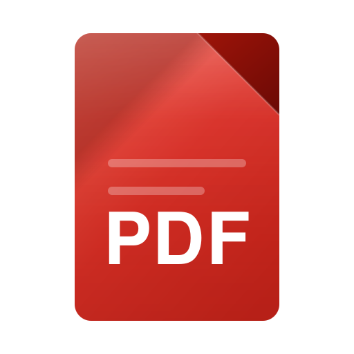

<div align="center">
  
  <h1>PDF</h1>
  <p><strong>Cititor PDF personal</strong> — fără reclame, fără conturi, fără telemetrie.</p>
</div>

Aplicația se numește pur și simplu **PDF** — un tool personal, fără branding.
Un singur renderer (React + PDF.js) este folosit pe următoarele ținte:

| Țintă | Formă | Status |
| --- | --- | --- |
| **Windows** | instalator NSIS (`PDF-Setup-1.2.1.exe`) | CI Windows verificat; instalarea nativă este de confirmat |
| **Linux** | AppImage + `deb` | pachetul `deb` 1.1.1 instalat și testat pe Dell |
| **Android** | APK semnat (Capacitor) + PWA instalabilă | APK 1.1.1 instalat și testat pe OnePlus 6T |
| **Web** | PWA instalabilă, funcționează offline | gata |

Descărcările sunt în [Releases](https://github.com/anervalens-netizen/pdf-reader/releases).

În release-urile 1.1.2 și 1.2.0, folosește `app-release.apk` pentru Android;
`app-debug.apk` este destinat depanării și folosește altă semnătură. Actualizarea directă
de la debug la release nu este posibilă fără migrarea datelor aplicației.

---

## Versiunea 1.2.1 — icon Fluent și navigare completă

- Identitate vizuală nouă: pictogramă PDF turcoaz/albastru/violet, vectorială, cu fundal transparent în exterior, pentru Windows, Linux, Android, PWA și splash.
- Bara de meniu vizibilă pe desktop: **Fișier**, **Editare**, **Vizualizare**, **Instrumente**, **Setări**, **Ajutor**. Acțiunile sunt conectate la funcțiile existente, inclusiv documente recente, salvarea unei copii, imprimare și organizarea paginilor.
- Meniu compact cu trei puncte pe Android/PWA, cu acces la funcții și ferestrele **Preferințe** / **Despre PDF**.
- Setări efective pentru temă (sistem/luminos/întunecat) și pentru verificarea automată a actualizărilor pe desktop; meniul nativ Electron nu mai trimite „Despre” la un link fictiv.
- Teste de regresie mobile pentru meniu, preferințe și About, plus testele PDF existente. Datele și semnăturile release-urilor anterioare rămân nemodificate.

---

## Versiunea 1.2.0 — editor extins

- Imprimare vectorială a copiei PDF, independentă de zoom și fără limita de 35 de pagini; verificată automat cu documente de 12 și 140 de pagini. Pentru PDF-uri parolate, aplicația poate produce o copie rasterizată temporară pentru tipărire, fără să modifice originalul. Pe Android, salvează o copie și imprimă din aplicația de sistem.
- Undo/Redo pentru adnotări (60 de operații, doar sesiunea documentului).
- Casete de text editabile și export în PDF, inclusiv diacritice românești. Salvarea este blocată dacă fontul nu poate reprezenta toate caracterele, pentru a evita pierderea lor.
- Semnătură din fotografie sau cameră; fundal eliminat local. Nu este semnătură digitală certificată.
- ChatGPT opțional pe desktop: autentificare OAuth, model disponibil în cont, întrebări despre text cu referințe la pagini. Textul este transmis către OpenAI numai la întrebarea utilizatorului, maximum 140.000 de caractere. Conversațiile sunt păstrate numai în memoria aplicației. Nu există OCR pentru scanări.
- Electron IPC cu autorizare verificată, restricții asupra fișierelor locale și tokenuri ChatGPT criptate de sistemul de operare, dacă este disponibil un seif de credențiale.
- Actualizări: verificare la pornire numai cu acord, descărcare explicită pentru Windows instalat și Linux AppImage. Android și Linux deb: instalare manuală.

Limitări de verificare: autentificarea reală ChatGPT, imprimanta fizică, instalatorul Windows și actualizarea unui release real necesită validare suplimentară. Cele șapte findings P2 din Codex Review PR #6 au remedieri și regresii dedicate în PR #7.

---

## Funcționalități

**Citire**
- Randare cu Mozilla PDF.js (text, vectori, imagini, formulare)
- Strat de text real → selectare, copiere, căutare funcționale
- Zoom (Ctrl+wheel, Ctrl++/−), potrivire pe lățime/pagină, navigare pe pagini
- Panou lateral cu miniaturi, cuprins (bookmarks) și lista de adnotări
- Căutare în text cu lista de rezultate și navigare între potriviri
- Temă caldă deschisă și temă neagră, plus „urmărește sistemul"

**Adnotări**
- Evidențiere și subliniere pe text selectat (5 culori)
- Notițe cu comentariu, desen liber cu stylus-ul, semnătură desenată
- Adnotările se păstrează local (IndexedDB) între sesiuni
- „Salvează o copie" scrie adnotările într-un PDF nou — fișierul original nu e atins niciodată

**Sistem**
- Deschidere prin dialog, drag & drop, asociere de fișiere `.pdf` (dublu clic în Explorator)
- Documente deschise recent + sesiune de citire (pagina și zoomul)
- Fereastră cu title bar personalizat și controale native Windows
- Meniu nativ, scurtături de tastatură, tipărire
- Pe Android: selector de fișiere al sistemului (SAF), buton „înapoi" care închide documentul

## Scurtături de tastatură

| Comandă | Acțiune |
| --- | --- |
| `Ctrl+O` | Deschide document |
| `Ctrl+F` | Caută în document |
| `Ctrl+S` / `Ctrl+Shift+S` | Salvează o copie cu adnotări |
| `Ctrl+P` | Tipărește |
| `Ctrl+B` | Arată/ascunde panoul lateral |
| `Ctrl+0` / `Ctrl+1` / `Ctrl+2` | Zoom 100% / potrivire lățime / potrivire pagină |
| `Ctrl++` / `Ctrl+-` | Mărește / micșorează |
| `Ctrl+Shift+D` | Comută tema |
| `PageUp` / `PageDown` | Pagina anterioară / următoare |
| `F3` / `Shift+F3` | Rezultatul următor / anterior |
| `H` `U` `N` `D` | Unelte: evidențiere, subliniere, notiță, desen |
| `Esc` | Anulează unealta / închide căutarea |

## Developere

```bash
npm ci
npm run dev         # pornește aplicația Electron cu hot reload
npm run dev:web     # pornește varianta web (PWA)
npm run typecheck   # verifică tipurile (main + renderer)
npm run build       # build de producție Electron în out/
```

### Scripturi auxiliare

```bash
npm run icons          # regenerează logo-ul și toate icoanele (desktop, PWA, Android)
npm run test:export    # test end-to-end pentru exportul de adnotări
xvfb-run -a npm run test:mobile # panou, navigare și zoom la dimensiune de telefon
npm run test:web       # QA end-to-end pentru build-ul web (randare + recente)
node scripts/make-sample-pdf.mjs   # creează samples/pdf-sample.pdf (12 pagini)
```

Capturile de QA se generează pornind aplicația cu:

```bash
PDF_CAPTURE_DIR=qa PDF_CAPTURE_PDF=samples/pdf-sample.pdf npx electron .
```

### Packaging

```bash
npm run dist:win     # instalator NSIS: release/PDF-Setup-1.2.1.exe
npm run dist:linux   # AppImage + deb
```

### Varianta web și Android

Rendererul e același; singura diferență e puntea `PdfApi`, care în browser
este implementată cu API-urile web (`<input type="file">`, File System Access
API, IndexedDB).

```bash
npm run build:web     # build static în dist-web/
npm run android:sync  # build web + copiere în proiectul Capacitor
npm run android:open  # deschide proiectul în Android Studio
```

APK-ul Android poate fi construit local cu JDK 21 și Android SDK 36, sau în CI.
După `npm ci` și `npm run android:sync`, `cd android && ./gradlew assembleRelease`
produce un APK nesemnat; CI îl semnează cu cheia dedicată și verifică semnătura.
Cheia și parola trebuie păstrate în afara repository-ului.

## Structura proiectului

```
src/
  main/       procesul Electron: fereastră, meniu, IPC, asocieri de fișiere
  preload/    puntea contextBridge (window.pdf) + rezolvarea drop-ului
  renderer/   aplicația React: shell, PDF.js, adnotări, IndexedDB
    public/   manifest PWA, service worker, iconele web
  shared/     tipuri comune între main și renderer
android/      proiectul nativ Capacitor (WebView + SAF)
scripts/      generatoare de icon/sample, teste, capturi QA
build/        logo-ul vectorial și icoanele rasterizate
```

## Stack

Electron 45 · React 19 · TypeScript 7 · Vite 8 · PDF.js 6.4 · pdf-lib 1.17 ·
Capacitor 8 · IndexedDB

## Versiunea 1.1.2 — utilizare pe telefon

- Panoul pornește închis pe ecrane înguste, are închidere vizibilă, se închide la atingerea fundalului sau selectarea paginii și respectă zona barelor sistemului.
- Zoomul este accesibil direct peste document prin butoane și prin gest cu două degete. Revenirea la potrivirea lățimii este disponibilă prin apăsarea procentului.
- O singură logică urmărește pagina vizibilă, pentru a evita schimbările repetate și salturile între pagini.
- Testele includ verificări automate ale panoului și zoomului și verificări pe OnePlus 6T cu Android 11. Funcționarea pe alte dispozitive și versiuni Android necesită confirmare.

## Versiunea 1.1.1 — formular PDF Unicode (remediere Codex)

- Exportul câmpurilor AcroForm cu caractere românești `ăâîșț` folosește un font Unicode Noto Sans încorporat în aspectul vizual al câmpului; datele sunt păstrate și în `/V`.
- Fontul este disponibil offline în aplicația desktop, Android și PWA (nu se descarcă la export). Este folosit doar când există text non-ASCII.
- Fallback-ul din 1.1.0 rămâne activ dacă fontul nu poate genera aspectul; afișează avertizarea, fără pierdere de text.
- Teste: verifică resursele Type0 ale aparenței PDF și un flux real în browser cu completare formular, Save Copy și redeschiderea rezultatului.
- Dependențe: `@pdf-lib/fontkit` (MIT) și Noto Sans (SIL OFL 1.1); licența fontului este inclusă în `licenses/NotoSans-OFL-1.1.txt`.

## Versiunea 1.1.0 — operații PDF de bază

- Rotire cu 90° a paginii curente.
- Extragere pagini cu intervale precum `1-3,5`, cu verificarea limitelor.
- Combinare a documentului curent cu un al doilea PDF ales prin dialogul sistemului.
- Separare în două documente după pagina aleasă; fiecare parte necesită salvare explicită.
- Originalul nu este suprascris. Adnotările și valorile editate sunt incluse prin export înainte de operație. Unele formulare interactive sau semnături digitale pot fi afectate prin reconstruirea paginilor.
- Interfață simplă accesibilă din butonul „Operații pagini”, pe Windows, Linux și Android.
- Regresii automate pentru rotire, intervale invalide, extragere, combinare, separare și integritatea originalului.

## Versiunea 1.0.3 — remedierea observațiilor Codex

Au fost citite review-urile automate din PR #1 și PR #2; corecțiile acestei versiuni țintesc defectele reproductibile identificate de Codex:

- Desktop: copiile salvate prin dialog sunt autorizate pentru redeschidere din „Recente”.
- IndexedDB: o listă de adnotări golită intenționat nu este repopulată din metadatele vechi; deschiderea așteaptă scrierile locale încă în curs înainte de citirea adnotărilor.
- Print: pentru maximum 35 de pagini, sunt montate și randate toate paginile înainte de apelarea dialogului; documentele mai mari cer salvarea unei copii și tipărirea din cititorul sistemului, în loc să printeze pagini goale. Pipeline-ul de tipărire rămâne dependent de zoom; limita este prezentă și în 1.1.1.
- Android: salvarea prin Storage Access Framework se execută în fir de fundal pentru a nu bloca interfața la furnizori de fișiere lenți.
- PWA: navigația cu HTTP 503 folosește interfața offline deja memorată în cache, cu test de regresie.
- Dependențe: `uuid` transitive actualizat prin override la ramura reparată 11.1.1+, cu audit npm curat.

La versiunea 1.0.3, aspectul Unicode al formularelor rămânea o limitare; versiunea 1.1.1 adaugă fontul încorporat și testele descrise mai sus. Caracterele care nu sunt acoperite de font folosesc fallback-ul cu avertizare.

## Versiunea 1.0.2 — integritatea datelor și stabilitate

- **IndexedDB**: confirmăm tranzacțiile numai la `oncomplete`. Eșecul stocării unui document nu mai este mascat; erorile la adnotări sunt afișate și recomandă salvarea unei copii PDF.
- **Adnotări**: modificările rapide sunt serializate per document, evitând suprascrierea stării noi cu o versiune veche.
- **Migrare**: la reimportul unui PDF identic păstrat în v1.0.0 sub cheia `web:<nume>`, sesiunile și adnotările sunt copiate către cheia SHA-256 fără ștergerea originalului. Fișierele diferite cu același nume nu sunt amestecate.
- **Electron**: accesul la fișiere este permis numai după autorizarea implicită prin dialogul sistemului, deschiderea din sistemul de operare sau drag-and-drop. Permisiunile sunt păstrate într-un fișier local de metadate, fără a trimite documente pe server. Fișierele din „Recente” neautorizate anterior necesită reselectare.
- **Performanță**: pagina și stratul text sunt demontate când sunt la distanță de viewport, fără a pierde sloturile necesare navigării. Un test de 140 de pagini a păstrat doar 3 canvas-uri active la finalul documentului.
- **Android**: suport în cod pentru „Deschide cu” prin intentul `ACTION_VIEW` și `ContentResolver`. Importul extern prin bridge este limitat la 32 MB pentru a reduce riscul de epuizare a memoriei; verificarea ulterioară pe telefon este descrisă la limitări.
- **QA**: teste de migrare a notițelor, două PDF-uri cu același nume, PDF deteriorat, document mare, plus test desktop pentru respingerea unei citiri neautorizate.

## Versiunea 1.0.1 — corecții și verificări

- Android: salvarea PDF folosește selectorul nativ de documente (SAF), fără permisiuni largi de stocare.
- Web/Android: identitate SHA-256 pentru documente, pentru a evita coliziunea dintre fișiere cu același nume. Datele anterioare din IndexedDB rămân accesibile.
- Export: valorile de formular AcroForm (text, checkbox, radio, dropdown) sunt mapate corect între PDF.js și pdf-lib; comentariile se păstrează integral în adnotări PDF de tip Text, inclusiv cu diacritice.
- Desktop: sandbox Electron activ și deschiderea fișierelor din sistem sincronizată cu pornirea rendererului.
- PWA: navigațiile folosesc network-first cu fallback offline. Bara de instrumente mobilă are scroll fără indicator deranjant.
- Teste: generare automată PDF de probă, verificări de export și formular, UI Web/Electron și regresii.
- PDF deteriorat: explicație explicită și recomandare de re-descărcare. Aplicația nu pretinde că poate repara orice fișier incomplet.

## Limitări cunoscute

- **Tipărirea** folosește copia PDF vectorială (independentă de zoom și fără limită de
  35 de pagini). Documentele protejate cu parolă folosesc o copie rasterizată temporară
  la maximum 144 dpi, independent de zoom, fără a modifica documentul original.
- **Adnotările exportate** sunt desenate ca conținut de pagină (aspect vizual identic), nu ca
  obiecte de adnotare PDF interactive.
- **Actualizările** sunt configurate pentru GitHub Releases: verificare manuală sau la
  pornire numai cu acord, descărcare explicită pentru Windows instalat și AppImage;
  pachetele Linux `.deb` și Android se actualizează manual.
- **Formularele** se completează interactiv (PDF.js), iar valorile sunt exportate în copia
  rezultată pe câmpurile care pot fi scrise.
- **Android**: pe OnePlus 6T cu Android 11 au fost verificate instalarea release, deschiderea unui PDF prin `ACTION_VIEW`, documentele recente și salvarea prin SAF. Alegerea din managerul de fișiere nu a fost verificată separat; importul extern este limitat la 32 MB.
- **Android**: APK-ul release este semnat cu cheia permanentă dedicată; CI verifică semnătura și publică artefactul. APK-ul debug are o semnătură diferită și nu se poate actualiza direct la release; datele trebuie migrate înainte de reinstalare. Secretele necesare sunt `ANDROID_KEYSTORE_BASE64`, `ANDROID_KEYSTORE_PASSWORD` și `ANDROID_KEY_ALIAS`.

## Verificări efectuate

La 29 octombrie 2026, pachetul `deb` 1.1.1 a fost instalat pe Dell; într-un afișaj
X virtual au fost verificate deschiderea, navigarea, căutarea, desenul și salvarea
unei copii PDF. Pe OnePlus 6T au fost verificate APK-ul release semnat, migrarea
locală a datelor, deschiderea și salvarea unui PDF. Instalarea nativă Windows și
workflow-ul complet de publicare pentru o versiune nouă rămân de verificat.

## Licență

MIT
